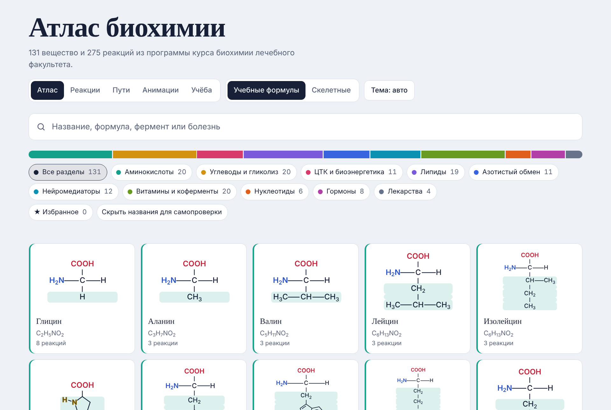

# Атлас биохимии

Интерактивный атлас веществ и реакций по программе курса биохимии лечебного факультета.



## Что внутри

- **Атлас:** 131 вещество в 10 разделах: аминокислоты, углеводы и гликолиз, ЦТК, липиды, азотистый обмен, нейромедиаторы, витамины и коферменты, нуклеотиды, гормоны, лекарства. У каждого вещества есть формула, молярная масса, роль в обмене, клиническое значение и блок «Как запомнить».
- **Формулы:** учебные (проекции Фишера и Хеуорса, развёрнутые формулы с цветом функциональных групп, кольца с нумерацией атомов) и скелетные. Скелетные строятся из SMILES.
- **Реакции:** 275 реакций с ферментами, кофакторами, локализацией и клиническим значением, классы ферментов по КФ.
- **Пути:** гликолиз, цикл Кребса, орнитиновый цикл, обмен триптофана.
- **Анимации:** дыхательная цепь и АТФ-синтаза, кинетика ферментов, кривая диссоциации оксигемоглобина, β-окисление, каскад цАМФ.
- **Учёба:** интервальное повторение, сборка формул, 49 пар «Не перепутай», шпаргалки по аминокислотам, витаминам и ферментопатиям.

## Как открыть

Скачайте `index.html` и откройте его в браузере. Для шрифтов и скелетных формул нужен интернет, остальное работает без него.

Прогресс повторения и избранное хранятся в браузере (`localStorage`). Если очистить данные сайта или открыть атлас в другом браузере, прогресс начнётся заново.

## Публикация на GitHub Pages

1. На GitHub нажмите **New repository**, задайте имя (например, `biochem-atlas`), выберите **Public** и нажмите **Create repository**.
2. На странице пустого репозитория нажмите ссылку **uploading an existing file**. Перетащите в окно все файлы и папки из этого архива: содержимое папки `biochem-atlas`, а не саму папку. Нажмите **Commit changes**.
3. Откройте **Settings → Pages**. В разделе **Build and deployment** выберите **Source: Deploy from a branch**, ветку **main** и папку **/ (root)**, нажмите **Save**.
4. Через одну-две минуты сайт будет доступен по адресу `https://<ваш-логин>.github.io/biochem-atlas/`.

На бесплатном аккаунте GitHub Pages работает только для публичных репозиториев.

## Как вносить изменения

Сайт собирается из шаблона и данных. Готовый `index.html` уже лежит в архиве, пересобирать его нужно только после правок.

| Файл | Что в нём |
| --- | --- |
| `data/substances.json` | Вещества: название, SMILES, формула, масса, описание, клиническое значение |
| `data/reactions.json` | Реакции: субстраты, продукты, фермент, кофакторы, локализация, комментарий |
| `data/formulas.json` | Учебные формулы для каждого вещества |
| `data/mnemonics.json` | Блок «Как запомнить» |
| `data/pairs.json` | Пары «Не перепутай» |
| `data/cheatsheets.json` | Шпаргалки: группы аминокислот, витамины, ферментопатии |
| `src/template.html` | Разметка, стили и код страницы |
| `build.py` | Собирает `index.html` из шаблона и данных |

После правки данных выполните в папке проекта:

```
python3 build.py
```

Скрипт проверит, что все ссылки на вещества существуют, и пересоберёт `index.html`. Нужен только Python 3.

## Оговорки

Атлас создан как учебный материал и не заменяет учебник. Лабораторные нормы ориентировочные и зависят от метода и лаборатории. Модели в анимациях упрощены.

Скелетные формулы рисует библиотека [SmilesDrawer](https://github.com/reymond-group/smilesDrawer) (MIT), шрифты Golos Text и Literata загружаются с Google Fonts.
